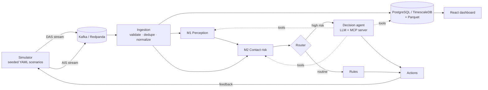

# CableGuard

**AI-driven protection system for submarine telecommunication cables**

CableGuard correlates two independent, asynchronous event streams — **Distributed Acoustic Sensing (DAS)** from a fiber-optic cable and **AIS** vessel reports — to detect threats such as dark vessels, anchoring over the cable, AIS spoofing and anchor drag. An LLM-based decision agent, exposed through an **MCP server**, orchestrates downstream AI models and triggers protective actions whose effects feed back into the simulation.

---

## 1. Project description

Submarine fiber-optic cables carry most intercontinental data traffic and are increasingly damaged by dragging anchors, bottom trawling and sabotage, as in the Baltic Sea incidents of 2023–2024 (Balticconnector, C-Lion1/BCS, Estlink 2). Operators monitor nearby ships mainly through AIS geofencing, which fails when a vessel switches off its transponder, falsifies its position, or looks normal on AIS while its anchor is on the seabed.

DAS turns an existing cable into thousands of vibration sensors that "hear" vessels regardless of what they broadcast. CableGuard correlates DAS acoustic windows with AIS reports, and an AI agent decides on protective actions: **monitor, hail the vessel over VHF, alert the coast guard, or reroute traffic** before an outage.

**Dataset:** [Marlinks-NS DAS dataset](https://github.com/UAH-PSI/das-vessel-detection) — 10 days of DAS recordings over a 2,553 m segment of a 28 km cable offshore Zeebrugge (Belgium), 74,771 windows of 10 s, each a 250-channel × 100-band energy matrix (4–98 Hz), labelled with the AIS-derived distance to the closest vessel.

## 2. Technical challenges

- **Weak, AIS-dependent labels** — ground truth exists only for vessels that reported on AIS; dark or spoofing vessels are absent by construction.
- **Restricted signal representation** — 10 s spectral energy windows only: no fine Doppler, sub-4 Hz or sub-second information; short linear segment (side-of-cable ambiguity); undisclosed cable route, so geometry is modelled.
- **Rare critical events** — no labelled anchor-drag or cable-strike events; they are synthesized, creating an explicit sim-to-real gap.
- **Asynchronous, heterogeneous streams** — DAS every 10 s, AIS irregular (seconds underway, minutes at anchor, with gaps); late, duplicated and out-of-order events must be handled and aligned in time and space.
- **Data volume and leakage** — around 15 GB feature tensor (float64); temporally correlated windows require day-wise splits; class imbalance (30% of windows have a vessel within 1 km).
- **Reliable autonomous decisions and a closed loop** — the LLM agent needs typed tools, guardrails, an audit trail and a fallback; its actions must change the simulated world reproducibly.

## 3. State of the art

| Approach | Pros | Cons |
|---|---|---|
| **Feature-based ML on the same cable** (Ramirez-Torres et al., 2025) — XGBoost / small NN on band energies, day-wise 10-fold CV | Large real dataset, rigorous evaluation, F1 > 90%, 141 m mean distance error | One site, ten days; detection and distance only — no tracking, AIS fusion or decisions |
| **Deep event detection on long DAS records** (Zhang et al., DASNet, Monterey Bay) | One model for earthquakes, whales and ships; near real time; validated against catalogs | Needs raw high-rate data and manual labelling; ship tracking only shown in examples; no action layer |
| **Physics-based tracking & AIS-guided datasets** (Landrø et al.; Rivet et al.; Huang et al., DASHip; Wienecke et al.) | Interpretable, can localize; trawler detection up to ~2.5 km | Few vessels or downsampled data; no defence against non-broadcasting vessels |
| **Operational practice** — AIS geofencing, patrols, commercial DAS services | Mature and simple | Defeated by switching AIS off or spoofing; manual, rule-based correlation |

**Gap:** existing work stops at perception. Few systems combine acoustic perception, AIS behaviour analysis and an automated decision-and-feedback loop — this is what CableGuard targets.

## 4. Solution

**Simulator** — configurable, seeded YAML scenarios. Stream 1 replays real DAS windows in time order (noisy channels 59–61 removed). Stream 2 generates AIS messages with realistic reporting intervals, with tracks fitted so their distance to a virtual cable matches the real labels and vessel types. Scenario injectors create dark vessels, loitering/anchoring over the cable, position spoofing, authorized maintenance vessels in a simulated port schedule, and synthetic anchor-drag signatures (labelled as synthetic).

**Data pipeline** — both streams go to a message broker. An ingestion service validates schemas, deduplicates, handles late events and normalizes data, storing it in PostgreSQL/TimescaleDB with raw events as Parquet.
- **Online inference:** M1 scores every incoming DAS window in streaming mode; M2 re-scores each contact on every new DAS or AIS event.
- **Offline ETL:** HDF5 → float32 shards, day-wise training folds, analytics, and replay of past incidents.

**AI models**
- **M1 — Perception:** lightweight CNN over channel × frequency, trained only on real data. Outputs vessel presence, distance, along-cable position and an anomaly score (autoencoder trained on normal windows).
- **M2 — Contact risk:** temporal model over fused contacts (M1 detections matched to AIS tracks). Multi-label risk scores: `NORMAL`, `DARK_CONTACT`, `ANCHORED_LOITERING`, `SPOOFING`, `BOTTOM_CONTACT`. Trained on simulator scenarios, including hard negatives.
- **Decision agent:** LLM behind an MCP server with tools `get_das_detections`, `run_perception`, `get_ais_tracks`, `get_risk_score`, `get_maintenance_schedule`, `execute_action`. Correlates the evidence and chooses an action (log, monitor, VHF hail, coast guard alert, optical reroute) with a written justification.

**Orchestration** — an event router calls the agent only when M1/M2 confidence exceeds thresholds; routine cases are handled by rules, and a deterministic policy takes over when the LLM is slow, unavailable or overloaded.

**Feedback loop** — actions return to the simulator: a hailed vessel complies with a profile-based probability and changes course or speed; an unaddressed drag damages the cable (channels go silent, outage cost recorded); unnecessary interventions incur a false-alarm cost.

**Backend & UI** — FastAPI services, Docker Compose deployment, React dashboard with a live waterfall, vessel map, alert feed and agent reasoning traces.

## 5. Evaluation

- **Model level:** M1 with day-wise 10-fold CV against the published baseline (F1, distance error); M2 by per-class precision/recall and PR-AUC on held-out scenarios.
- **End to end:** time to alert, prevented strikes, false alarms per day, operational cost, agreement with an oracle policy.
- **Failure, drift and high-load scenarios:** channel dropout or fiber damage, weather-driven drift on high-wind days, AIS spoofing, high load (10× replay plus a vessel burst, with LLM failure).

