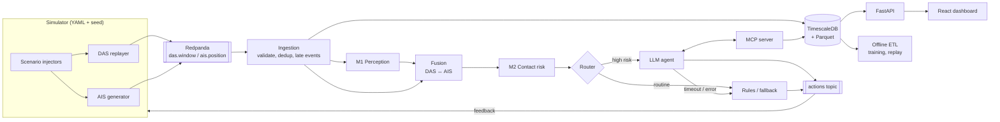
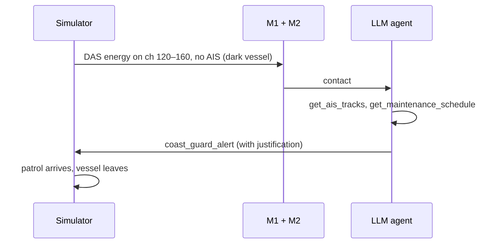

# CableGuard: Architecture and Implementation Plan (Milestone 2)

This document explains how our project, CableGuard, will be built, tested and evaluated.
The motivation and state of the art are in the [README](../README.md).

## 1. Problem and stakeholders

Fishing and anchoring cause more than 80 % of submarine cable faults ([ICPC/SubOptic repair data](https://www.submarinenetworks.com/en/nv/insights/statistics-on-subsea-cable-fault-and-repair)). Operators watch nearby ships through AIS geofencing, which fails when a vessel turns off its transponder, spoofs its position or drags its anchor while reporting normal behaviour. CableGuard uses the cable itself as a sensor (DAS) and combines what it hears with AIS, so such vessels can still be caught.

| Stakeholder           | What they need                                         |
|-----------------------|--------------------------------------------------------|
| Cable operator (NOC)  | Early warning, fewer outages and repairs               |
| Coast guard           | Alerts backed by position, track and acoustic evidence |
| Vessel operators      | Not to be stopped without reason                       |

**Supported decision:** for each contact near the cable, the system chooses one action: `log`, `monitor`, `vhf_hail`, `coast_guard_alert` or `reroute_traffic`.

A *contact* is a vessel detected near the cable by DAS, AIS or both. "Near" means within 1 km, the detection threshold used by the Marlinks-NS paper; bottom trawlers have been detected on DAS up to 2.5 km away (Wienecke et al.), so vessels further out are tracked through AIS only.

## 2. Data sources

| Stream               | Source                                                                                                                | Structure                                                                                                | Frequency                                                                          |
|----------------------|-----------------------------------------------------------------------------------------------------------------------|----------------------------------------------------------------------------------------------------------|------------------------------------------------------------------------------------|
| DAS windows          | Real: [Marlinks-NS](https://github.com/UAH-PSI/das-vessel-detection), 10 days, 74,771 windows, replayed in time order | 250 channels × 100 bands (4–98 Hz, mains band 49–51 Hz excluded), labelled with distance to the closest AIS vessel; noisy channels 59–61 removed | Every 10 s                                                                         |
| AIS reports          | Simulated: tracks fitted so their distance to a virtual cable matches the DAS labels                                  | `mmsi`, `ts`, `lat`, `lon`, `sog`, `cog`, `heading`, `nav_status`, `ship_type`                           | 2–10 s underway, 3 min at anchor, with injected gaps, duplicates and late messages |
| Maintenance schedule | Simulated                                                                                                             | Authorised vessels and time windows                                                                      | On change                                                                          |

Seeded YAML scenarios inject dark vessels, loitering over the cable, position spoofing, authorised maintenance ships and synthetic anchor-drag signatures. The same `(config, seed)` always gives the same run. New data enters the system as events on two broker topics, `das.window` and `ais.position`.

## 3. Architecture

**Main choices**
- **Redpanda** uses the Kafka API but runs as one container, which is enough for a laptop setup.
- **TimescaleDB** stores both time series and the relational data (decisions, vessels, schedule) in one PostgreSQL database. Raw events and the large DAS tensors go to Parquet.
- **Late events:** fusion waits up to 60 s (six DAS windows) before closing a time bucket. Messages arriving later are stored for replay but not used for live decisions.
- **Simulator ground truth** (true positions, dark or spoofing flags) is stored in a separate table and used only for evaluation.

### Feedback loop

Actions go back to the simulator. A hailed vessel complies with a probability based on its profile, a coast guard alert sends a patrol after a delay, and rerouting avoids the outage at a cost. A drag that is ignored damages the cable (channels go silent, outage cost recorded), and an action against a harmless vessel adds a false-alarm cost.

## 4. AI components

| Component                                                 | Input                                                                                                | Output                                                                            | Why                                                                                                                               |
|-----------------------------------------------------------|------------------------------------------------------------------------------------------------------|-----------------------------------------------------------------------------------|-----------------------------------------------------------------------------------------------------------------------------------|
| M1 Perception (CNN + autoencoder)                         | One DAS window, 247 × 100 log-energy                                                                 | Vessel presence, distance, along-cable position, anomaly score                    | Treats the window as an image and runs in milliseconds; the autoencoder flags signatures that have no labels, such as anchor drag |
| M2 Contact risk (GRU; gradient-boosted trees as fallback) | Sequence of fused contacts: M1 outputs + AIS speed, course, gaps, AIS–DAS mismatch, maintenance flag | Risk per type: `DARK_CONTACT`, `ANCHORED_LOITERING`, `SPOOFING`, `BOTTOM_CONTACT` | Risk depends on behaviour over minutes, not on one window                                                                         |
| Decision agent (LLM with tool calling)                    | M1/M2 outputs and evidence pulled through MCP tools                                                  | One action + written justification                                                | Combines different kinds of evidence and explains itself to the operator                                                          |

**MCP tools:** `get_das_detections`, `run_perception`, `get_ais_tracks`, `get_risk_score`, `get_maintenance_schedule`, `execute_action`. The agent has no other access to the system.

**Guardrails:** only the five actions are accepted; `reroute_traffic` needs risk ≥ 0.9 and an acoustic detection; a contact goes to the LLM at most once every 10 minutes unless its risk type changes. Every prompt, tool call and decision is logged and shown in the dashboard.

**Routing:** low-risk contacts are logged or monitored by rules. High-risk contacts, or ones where AIS and DAS disagree, go to the LLM. If the LLM takes longer than 10 s, fails or is overloaded, a deterministic decision table decides instead. All thresholds are starting values in `config/*.yaml`, tuned on validation seeds only.

## 5. Training and inference

- Training runs offline in `training/` (Colab), never inside the live pipeline.
- **M1** is trained on real Marlinks-NS data only, with day-wise 10-fold cross-validation, because neighbouring 10 s windows are strongly correlated. The autoencoder sees only windows with no vessel within 3 km.
- **M2** is trained on simulator runs with training seeds and tested on different seeds.
- Models are exported (ONNX / joblib) to `models/<name>/<version>/` with a short card (data hash, metrics). The inference service loads the version marked active in the database and reloads it when that changes.
- The LLM is not trained; prompts and tool schemas are versioned in the repo.

## 6. Evaluation

| Level      | Baseline | Metrics | Data |
|------------|---|---|---|
| M1         | Published XGBoost on the same data (Ramirez-Torres et al., IEEE JSTARS 2026): F1 90.11 % at the 1 km threshold, distance MAE 141 m | F1, distance MAE, position error | Day-wise 10-fold CV (leave one day out), as in the paper |
| M2         | Rules: < 3 kn within 500 m of the cable, or AIS gap > 10 min | Precision, recall, PR-AUC per risk type | Held-out seeds |
| Agent      | Deterministic decision table | Valid-action rate, agreement with an oracle that sees ground truth, p95 latency | Held-out scenarios |
| End to end | AIS-only geofencing; oracle as upper bound | Time to alert, strikes prevented, false alarms per day, total cost | 20 runs (5 scenario types × 4 seeds), same seeds for every policy |

Synthetic anchor-drag results are reported separately from results on real data, because the drag signature is simulated.

**Failure and load scenarios**
- **Main failure:** a dark vessel drags its anchor while the LLM is down. The question is whether the fallback still alerts before the strike.
- **Fiber damage:** a block of channels goes silent; M1 must not read it as "no vessel".
- **Drift:** the dataset's daily weather summary shows a calm period (maximum wind 3.9–9.5 m/s), so M1 is tested on the windiest day (19 June, waves up to 1.3 m) against the calmest (22 June), and on added synthetic noise to simulate rougher weather.
- **Spoofing:** AIS positions shifted by 1–5 km.
- **High load:** 10× replay speed plus 50 extra vessels in 30 min, measuring ingestion lag, dropped events and how many decisions fall back to rules.

## 7. Implementation plan

| Week | Dates        | Work                                                                                     | Result                                    |
|------|--------------|------------------------------------------------------------------------------------------|-------------------------------------------|
| 1    | 17–23 Nov    | This document; repo skeleton; Docker Compose (Redpanda, TimescaleDB); HDF5 → float32 ETL | Data loads, day-wise folds                |
| 2    | 24–30 Nov    | Simulator v1 (DAS replay, AIS generator, seeds); ingestion service                       | Both streams in the database              |
| 3    | 1–7 Dec      | M1: reproduce XGBoost baseline, then CNN + autoencoder                                   | M1 vs. published baseline                 |
| 4    | 8–14 Dec     | Scenario injectors; fusion; M2 and rule baseline                                         | M2 scores on held-out seeds               |
| 5    | 15–21 Dec    | MCP server, LLM agent, router, fallback, guardrails                                      | Agent tested on 10 scenarios              |
| 6    | 22–28 Dec    | Feedback loop; FastAPI; React dashboard v1                                               | First closed-loop run                     |
| 7    | 29 Dec–4 Jan | Buffer; **31 Dec review: full loop running**                                             | Demo: dark vessel stopped before a strike |
| 8    | 5–11 Jan     | End-to-end evaluation, all policies compared                                             | Results table                             |
| 9    | 12–18 Jan    | Failure, drift and load scenarios                                                        | Scenario results                          |
| 10   | 19 Jan       | Report, demo, presentation                                                               | Final presentation                        |
